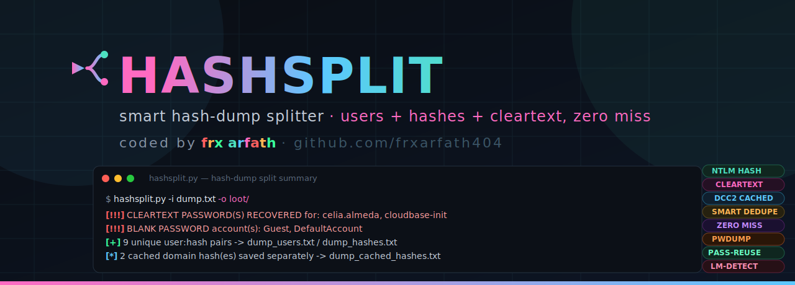

<p align="center">
  
</p>

<p align="center">
  <b>Turns a messy hash dump into two clean files: one for usernames, one for hashes.</b><br>
  Works with secretsdump, NetExec (nxc), pwdump — any dump, any junk lines around it.
</p>

<p align="center">
  
  
  
</p>

<p align="center"><i>coded by <b>frx arfath</b> · <a href="https://github.com/frxarfath404">github.com/frxarfath404</a></i></p>

---

> ⚠️ **Only use this on systems you own or have permission to test (OSCP labs, CTFs, etc).** Using it on anything else is illegal.

## Why use this

You dumped SAM/NTDS/LSA secrets and now you've got 20-30 lines like:

```
CORP.LOCAL\Administrator:500:aad3b435b51404eeaad3b435b51404ee:31d6cfe0d16ae931b73c59d7e0c089c0:::
CORP.LOCAL\krbtgt:502:aad3b435b51404eeaad3b435b51404ee:7a38310ea6f0027ff5eb0538c92a6ba9:::
```

Copy-pasting usernames and hashes into two separate wordlists by hand is slow and error-prone. `hashsplit.py` reads that raw text and instantly hands you back:

- `dump_users.txt` — one username per line
- `dump_hashes.txt` — the matching NT hash per line, same order

Line N in one file always matches line N in the other, so they drop straight into hashcat or any pass-the-hash tool.

It also **flags the important stuff automatically**:

- ✅ Blank passwords (instant login, no cracking needed)
- ✅ krbtgt captured (Golden Ticket material)
- ✅ Same hash reused on multiple accounts (crack one, own them all)
- ✅ A real LM hash present (cracks way faster than NTLM)

## Install

```bash
git clone https://github.com/frxarfath404/hashsplit.git
cd hashsplit
pip install -r requirements.txt
chmod +x hashsplit.py
```

## Make it run from anywhere (optional but handy)

```bash
sudo ln -sf "$(pwd)/hashsplit.py" /usr/local/bin/hashsplit
```

Now you can just type `hashsplit` from any folder.

## How to use it

```bash
# split a dump file
hashsplit -i dump.txt

# split a dump file, save to a specific folder
hashsplit -i dump.txt -o loot/

# multiple dump files at once
hashsplit -i sam_dump.txt lsa_dump.txt

# also write a combined "user:hash" file
hashsplit -i dump.txt --combined

# read from stdin (pipe straight from secretsdump)
secretsdump.py -sam sam.save -system system.save LOCAL | hashsplit
```

### The main flags you'll actually use

| Flag | What it means |
|---|---|
| `-i` | one or more dump files (omit to read from stdin) |
| `-o` | output folder (default: current folder) |
| `--combined` | also write `dump_combined.txt` with `user:hash` pairs |
| `--include-history` | keep password-history entries (skipped by default) |
| `--skip-machine-accounts` | drop computer accounts ending in `$` |
| `-v` | print every user:hash pair found, not just the summary |

Run `hashsplit -h` to see everything.

## Example output

```
[!!!] CLEARTEXT PASSWORD(S) RECOVERED for: celia.almeda, cloudbase-init
[!!!] BLANK PASSWORD account(s): Guest, DefaultAccount
[+] 9 unique user:hash pairs -> dump_users.txt / dump_hashes.txt
[*] 2 cached domain hash(es) saved separately -> dump_cached_hashes.txt
```

Now crack it straight away:
```bash
hashcat -m 1000 dump_hashes.txt rockyou.txt --username
```

---

<p align="center">Made for the grind. Good luck on the OSCP. 🐺<br>
<sub>MIT License · © 2026 Mohammed Arfath (frx arfath)</sub></p>
